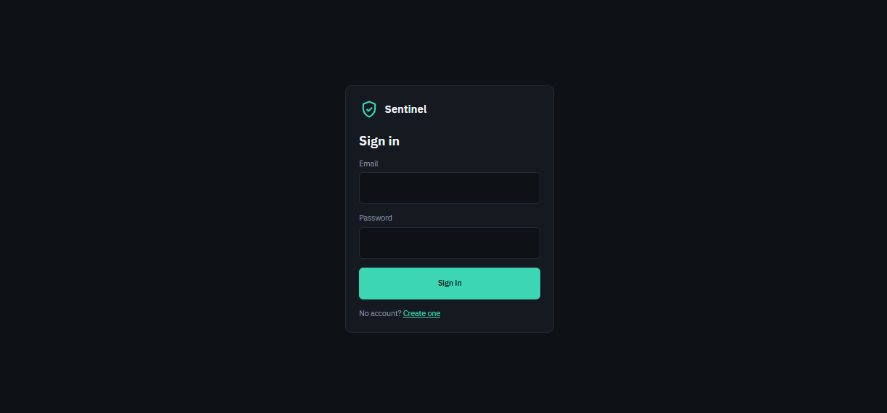
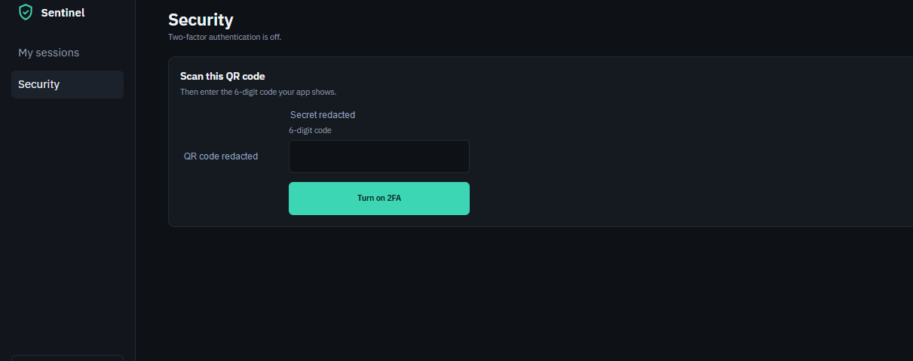

<div align="center">

# 🛡️ Sentinel

**A secure authentication and access-management service with an admin dashboard.**

Sign-in, session control and two-factor authentication (2FA), built as a full-stack project.


[Live Demo](#) · [Backend API](#) · [Report a Bug](../../issues)

</div>

---

## 📸 Screenshots

| Sign in | Security (2FA setup) |
|---|---|
|  |  |

---

## 📖 Overview

Most apps need a login system, and most login systems are either too basic or copy-pasted without much thought for security. **Sentinel** is a standalone auth service that handles the hard parts properly: account creation, sign-in, session tracking, and an extra layer of protection with time-based one-time passwords (TOTP).

A React dashboard sits on top of the API so users can see where they are signed in and manage their own account security.

## ✨ Features

- **Account registration and sign-in** with email and password
- **Two-factor authentication (2FA)** using any authenticator app (Google Authenticator, Authy, etc.)
  - Scan a QR code, or enter the manual key
  - Confirm with a 6-digit code before 2FA is switched on
- **Session management**: view your active sessions from the "My sessions" page
- **Security page**: see the current 2FA status and turn it on from one place
- **Admin dashboard** built in React
- **Clean separation**: independent `frontend` and `backend` folders

## 🧱 Tech Stack

| Layer | Technology |
|---|---|
| Frontend | React, CSS |
| Backend | Node.js, Express.js |
| Auth | Password-based login + TOTP 2FA |
| Frontend hosting | Vercel |
| Version control | Git, GitHub |

## 📂 Project Structure

```
sentinel/
├── backend/        # Node.js + Express API
├── frontend/       # React app (sign-in, sessions, security)
├── docs/
│   └── screenshots/
│       ├── sign-in.png
│       └── security-2fa.png
└── README.md
```

## 🔐 How 2FA Works

1. The user opens the **Security** page and starts 2FA setup.
2. The server generates a secret and the frontend shows it as a **QR code** (plus a manual key).
3. The user scans it with an authenticator app, which starts producing a new 6-digit code every 30 seconds.
4. The user enters the current code and clicks **Turn on 2FA**.
5. The server verifies the code against the secret. If it matches, 2FA is enabled on the account.

## 🚀 Getting Started

### Prerequisites
- Node.js 18+
- npm

### 1. Clone the repo
```bash
git clone https://github.com/0xAlpha01/sentinel.git
cd sentinel
```

### 2. Run the backend
```bash
cd backend
npm install
cp .env.example .env   # then fill in your values
npm run dev
```

### 3. Run the frontend
```bash
cd frontend
npm install
npm start
```

The app will open at `http://localhost:3000`.

## 🔑 Environment Variables

Create a `.env` file in `backend/`:

```env
PORT=5000
JWT_SECRET=your_long_random_secret
# add your database URL and any other values your backend uses
```

## 🛡️ Security Notes

- Never commit your `.env` file
- Passwords are stored hashed, never in plain text
- 2FA secrets should only be shown once, during setup

## 🗺️ Roadmap

- [ ] Backup / recovery codes for 2FA
- [ ] Revoke individual sessions from the dashboard
- [ ] Role-based access control
- [ ] Rate limiting on sign-in attempts

## 👤 Author

**Amoo Abdulmueez** (0xAlpha)
GitHub: [@0xAlpha01](https://github.com/0xAlpha01)

---

⭐ If you found this project useful, consider giving it a star.